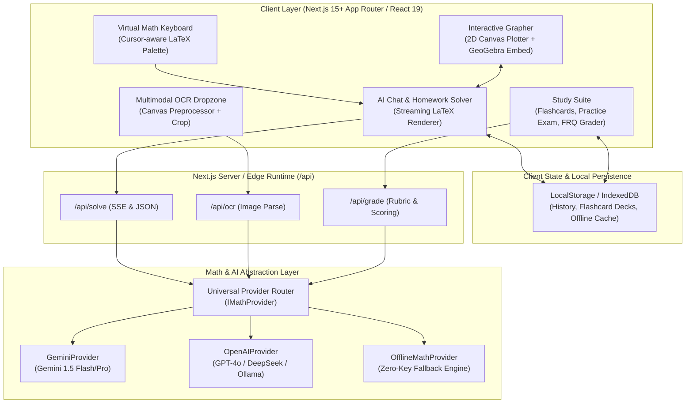

# OpenMath Architecture & Technical Design

This document details the system design, core modules, data flows, and design decisions behind **OpenMath**.



---

## 1. Provider Adapter Pattern

All mathematical reasoning operations adhere to the `IMathProvider` contract (`src/core/providers/types.ts`):

```typescript
export interface IMathProvider {
  readonly name: string;
  isAvailable(): boolean;
  solve(request: ProviderSolveRequest): Promise<MathSolution>;
  solveStream(request: ProviderSolveRequest): AsyncIterable<string>;
}
```

- **`OfflineMathProvider`**: Runs fully locally with zero external network access. It performs symbolic arithmetic, linear equation solving, power derivatives, and fuzzy keyword matching against a curated benchmark corpus.
- **`GeminiProvider`**: Interfaces with Google Gemini 1.5 Flash / Pro via direct HTTP calls with multimodal inline image bytes.
- **`OpenAIProvider`**: Connects to OpenAI-compatible endpoints (supporting GPT-4o, Groq, DeepSeek, and local Ollama instances).

---

## 2. LaTeX Streaming & Delimiter Balancing

When LLMs stream tokens, closing `$` or `$$` delimiters may arrive in later packets. To avoid KaTeX fatal errors or layout stuttering, the parser pipeline invokes `balanceUnclosedDelimiters`:

```
Raw Token Stream -> normalizeLatexDelimiters -> balanceUnclosedDelimiters -> parseMathSegments -> KaTeX HTML
```

---

## 3. Spaced Repetition (SM-2)

The flashcard study engine implements the SuperMemo SM-2 algorithm (`src/core/srs/sm2.ts`):
- Interval progression: $I(1) = 1$, $I(2) = 6$, $I(n) = I(n-1) \times EF$.
- Dynamic ease factor adjustment based on user recall grade (1-5).
- Persisted client-side for private, instant, offline-first study sessions.
